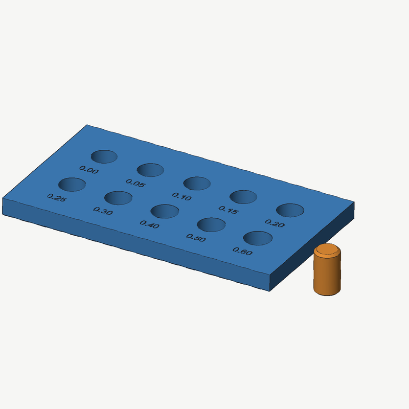

# ObjectDesign template

A starting point for **agent-driven, parametric 3D-printable designs**. You describe a part
in plain language, and an AI coding agent (Claude Code, or anything that reads `AGENTS.md`)
writes it as Python CAD code. It then checks the part, renders previews and exports print
files. Designs stay as code, so you and the agent can both keep editing them.



- **CAD:** [build123d](https://github.com/gumyr/build123d) (Python, OpenCascade)
- **Preview:** VS Code + [OCP CAD Viewer](https://marketplace.visualstudio.com/items?itemName=bernhard-42.ocp-cad-viewer), live-updating on save
- **Tooling:** [uv](https://docs.astral.sh/uv/) + the `od` CLI in `src/od/` (check, render, build, release)
- **Any FDM printer and slicer:** describe yours in `printer.toml`
- **Any git host with Git LFS** (GitHub, GitLab, Forgejo, …) for meshes and images

## How the workflow goes

1. **Ask for a design:** "a wall hook for a 30 mm broom handle, two M4 screws". The agent scaffolds `projects/<name>/` and writes a brief: dimensions, what it mates with, materials, print orientation and open questions. **It stops for you to confirm the brief.**
2. **The agent models it** in `projects/<name>/design.py`. Every dimension is a named parameter, and the brief's key dimensions are asserted in `verify()`.
3. **Review loop:** `od check` (geometry is valid, it fits your bed, overhangs and walls are sane, `verify()` passes), then `od render` (contact-sheet PNG the agent actually looks at). It repeats until clean.
4. **You print it.** `od build` gives you a 3MF with one named object per material.
5. **Iterate** after the test print, on a branch per change. When a version is good, `od release` exports it, commits it and tags `<name>/vN`.

STL remixes work too: give it an STL and it either modifies the mesh or re-creates it as clean parametric code.

## Make it yours

1. **Create your repo:** click **Use this template** on GitHub (or clone and re-point `origin`).
2. **Describe your printer** in [`printer.toml`](printer.toml): bed size, material slots (AMS/MMU/toolchanger, or 1), nozzle and slicer. Checks and tolerances read it.
3. **Print the calibration test,** [`projects/tolerance-test`](projects/tolerance-test/), and put your measured fits into [`src/od/tol.py`](src/od/tol.py). Every design then uses clearances tuned to your printer.
4. **Optional:** change the project title in this README, and the `name`/`description` in `pyproject.toml`.

## Setup (macOS or Windows)

1. Install:
   - **uv**: macOS `brew install uv`, Windows `winget install astral-sh.uv`
   - **Git + Git LFS**: macOS `brew install git git-lfs`, Windows [Git for Windows](https://git-scm.com/download/win) (includes LFS)
   - **VS Code** with the *OCP CAD Viewer* and *Python* extensions (VS Code suggests them when you open this folder)
   - **Your slicer**, for example Bambu Studio, OrcaSlicer or PrusaSlicer
   - **An AI coding agent**, for example [Claude Code](https://claude.com/claude-code). The repo ships Claude Code skills, and `AGENTS.md` works with other agents.
2. Clone your repo, then:
   ```sh
   git lfs install
   uv sync            # installs Python 3.14 + all CAD libraries into .venv
   uv run od setup    # checks everything and shows the printer it loaded
   ```
3. In VS Code, select the `.venv` interpreter when prompted.

## Everyday use

| Want to… | Do |
|---|---|
| New design | Ask your agent (`/new-design` in Claude Code), or `uv run od new <name>` |
| Start from an STL | `/remix-stl`, or `uv run od new <name> --from-stl file.stl` |
| Change a design | `/iterate`, or edit `Params` at the top of `design.py` |
| See a design | Open `projects/<name>/design.py` in VS Code. The **Live preview** task (starts with the folder) shows the design you last saved, and re-shows it on every save and whenever the viewer reopens. Or run the file (▶ / F5). |
| Reopen the viewer | **Cmd+K, then V** (Windows: Ctrl+K, V), or Command Palette → "OCP CAD Viewer: Open viewer" |
| See a variant | VS Code: Run and Debug → **"Preview design variant…"**, type a name or `all`. Or `uv run od view <name> --variant small` |
| Check it | `uv run od check <name>` |
| Preview images | `uv run od render <name>` → `projects/<name>/build/renders/` (also refreshes the README image `renders/hero.png`) |
| Get print files | `uv run od build <name>` → `projects/<name>/build/` (3MF, STEP, STL) |
| Mark a version as final | `/release`, or `uv run od release <name>` → `exports/`, commit, tag `<name>/vN` |

**Multi-material:** each part in a design (e.g. `body`, `label`) is a separate named object in the 3MF. Load it in your slicer as one object with several parts, assign a filament/tool to each, and save the slicer project next to the design (`projects/<name>/<name>.3mf`).

## Layout

```
printer.toml         your printer: bed, material slots, nozzle, slicer
AGENTS.md            rules for AI agents (CLAUDE.md imports it)
src/od/              CLI + shared library (tolerances, printer, mesh helpers, renderer, viewer)
projects/<name>/     one folder per design: design.py, README.md, refs/, exports/, renders/
.claude/skills/      Claude Code slash commands: /new-design, /remix-stl, /iterate, /release
docs/                images for this README (kept out of Git LFS)
```

## Projects

| Project | Description |
|---|---|
| [tolerance-test](projects/tolerance-test/) | Fit-clearance calibration print. Print this first |

## License

[MIT](LICENSE). Designs you create in your own copy are yours to license however you like.
