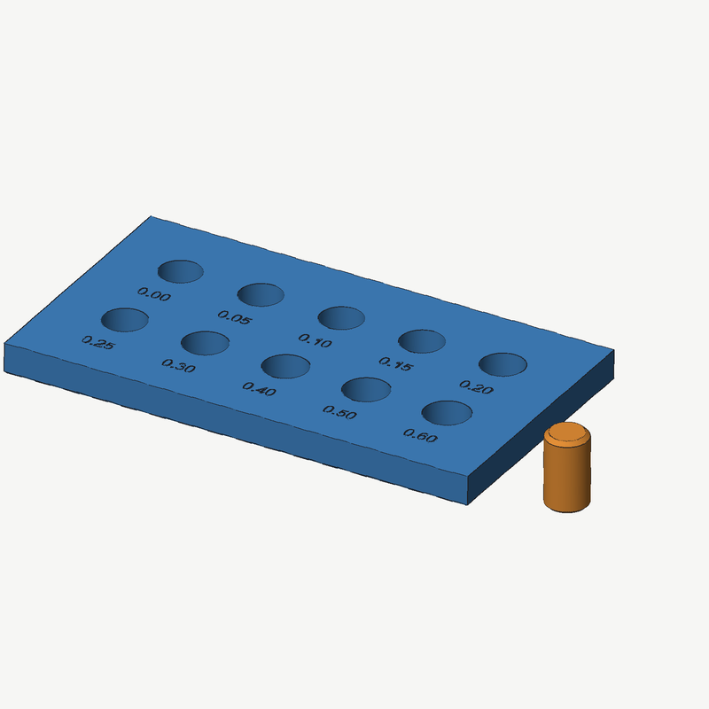

# Tolerance Test

**Status:** ready to print

## Brief

- **Purpose:** Calibrate the shared fit clearances in [`src/od/tol.py`](../../src/od/tol.py) for your printer (`printer.toml`).
- **Key dimensions:** peg Ø8.00 × 14 mm. Holes are Ø8 + {0, .05, .10, .15, .20, .25, .30, .40, .50, .60} mm, 6 mm deep, labeled.
- **Mates with:** itself (peg ↔ holes).
- **Materials / tools:** `plate` and `peg` are separate parts. Print them in the material you use most. Assign different tools to test fits between materials.
- **Print orientation:** plate flat. Peg standing up, so its axis matches the vertical holes.
- **Constraints:** no supports. Holes are deliberately *not* compensated, so the test measures the raw printer.

## How to use

1. Print with your everyday profile (0.2 mm layers, 0.4 mm nozzle).
2. Push the peg into each hole and note the smallest clearance that is:
   - **press**: goes in with firm force and stays
   - **snug**: goes in by hand with no wobble
   - **sliding**: moves freely with minimal play
   - **loose**: drops in
3. Update `PRESS`, `SNUG`, `SLIDING` and `LOOSE` in `src/od/tol.py`. If even 0.00 is too loose or 0.60 too tight, adjust `HOLE_COMPENSATION` and reprint.
4. Record the results and filament below.

## Source

Original design.

## Results

| Date | Filament | Press | Snug | Sliding | Loose |
|---|---|---|---|---|---|
| | | | | | |

## Changelog

- 2026-11-26: created
